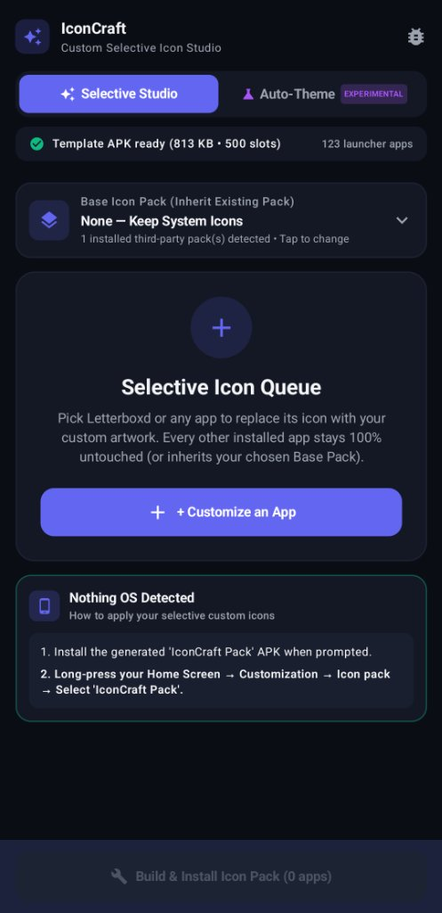
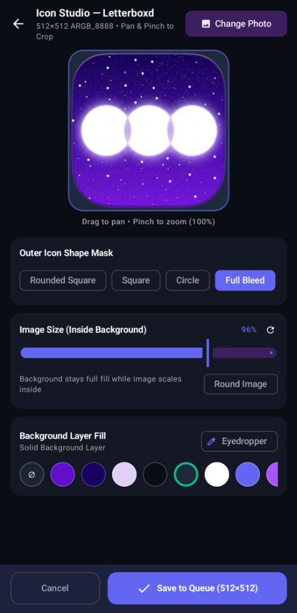
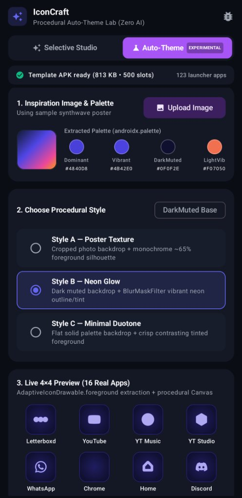

<div align="center">


# IconCraft

**Custom icons for any app you choose — no subscriptions, no custom launcher required.**

[](#will-it-work-on-my-phone)
[](#privacy--play-protect-faq)
[](LICENSE)
[](../../releases/latest)
[](https://github.com/tkdesigns25/IconCraft/actions/workflows/android-ci.yml)

[**Download**](https://github.com/tkdesigns25/IconCraft/releases/latest) • [**Features**](#-features) • [**Compatibility**](#-will-it-work-on-my-phone) • [**How It Works**](#-how-to-use) • [**FAQ**](#-privacy--play-protect-faq)

<br />

<a href="https://github.com/tkdesigns25/IconCraft/releases/latest">
  
</a>

</div>

---

## 📸 Screenshots

<div align="center">
<table>
  <tr>
    <td align="center" width="33%">
      
      <br />
      <sub><b>Home & Base Pack Queue</b></sub>
    </td>
    <td align="center" width="33%">
      
      <br />
      <sub><b>Built-in Icon Studio</b></sub>
    </td>
    <td align="center" width="33%">
      
      <br />
      <sub><b>Auto-Theme Lab</b></sub>
    </td>
  </tr>
</table>
</div>

---

## ✨ Features

- 🎯 **Pick Only the Apps You Want** — Swap just *Letterboxd*, *Spotify*, or a few favorites using your own images; every other app on your phone stays completely untouched.
- 🧩 **Keep Your Existing Icon Pack** — Already using an icon pack you love? Select it as your **Base Pack** and IconCraft will merge your custom overrides right on top of it.
- 🎨 **Built-in Icon Studio** — Crop, zoom, adjust inner image padding, toggle rounded corners, and pick matching background colors without needing an external photo editor.
- 🧪 **Auto-Theme Lab (Experimental)** — Upload a single movie poster or wallpaper to automatically style your apps in matching colors (*Poster Texture*, *Neon Glow*, or *Minimal*) — 100% offline with zero AI subscriptions.
- 📱 **1×1 Home Widget Fallback** — Even on phones that block custom icon packs (like Google Pixel), place clean custom icons on your Home Screen with **no ugly shortcut watermarks**.

---

## 📱 Will It Work on My Phone?

| Phone / Setup | Support Level | How It Works |
| :--- | :--- | :--- |
| **OnePlus / Oppo / Realme** *(OxygenOS / ColorOS / Realme UI)* | ✅ **Full Native Support** | Apply directly in Home Screen settings → *Icons* → **IconCraft Pack** |
| **Nothing Phone** *(Nothing OS)* | ✅ **Full Native Support** | Long-press Home Screen → *Customization* → *Icon pack* → **IconCraft Pack** |
| **Samsung Galaxy** *(One UI)* | ⚠️ **Via Good Lock** | Apply using Samsung's official **Good Lock → Theme Park → Icon → Iconpack** |
| **Xiaomi / Poco / Redmi** | ⚠️ **HyperOS 3+ / Widget** | Native icon pack support on newer HyperOS 3+ launchers; **1×1 Widget** on older MIUI |
| **Any Android + Custom Launcher** *(Nova, Lawnchair, Smart Launcher, Niagara)* | ✅ **Full Native Support** | Select **IconCraft Pack** in your launcher's icon pack settings or per-app editor |
| **Google Pixel / Motorola / Stock Android** | 🧩 **1×1 Widget / Custom Launcher** | Use IconCraft's **1×1 Home Widget** (watermark-free on Home Screen) or a custom launcher |
| **iPhone** *(iOS)* | ❌ **Not Supported** | Android only (requires Android 8.0 or newer) |

---

## 🚀 How to Use

1. **Install IconCraft:** Download the latest `.apk` from [**GitHub Releases**](https://github.com/tkdesigns25/IconCraft/releases/latest) and open it on your phone.
2. **Design Your Icon:** Tap **Customize an App**, pick the app you want to change (e.g., *Letterboxd*), and select any image from your gallery.
3. **Build Your Pack:** Tap **Build & Install Icon Pack** — your phone will package and prompt you to install your personal `IconCraft Pack`.
4. **Apply & Enjoy:** Follow the quick 2-step guide shown inside the app for your phone brand to activate **IconCraft Pack**.

> [!TIP]
> **Want to add or edit more icons later?** Just open IconCraft, add or edit an app in your queue, and tap **Build & Install Icon Pack** again. It updates your existing pack in place so you don't lose any of your previous custom icons.

---

## 🔒 Privacy & Play Protect FAQ

> [!NOTE]
> **Zero `INTERNET` permission. Zero ads. Zero tracking.**
> IconCraft is 100% offline — it does not even ask Android for internet access. Your photos and installed app list never leave your phone.

<details>
<summary><strong>Why does Android / Google Play Protect show an "Unknown app" warning?</strong></summary>
<br />
Because IconCraft is an independent open-source app distributed on GitHub (not the Google Play Store) and builds a custom icon pack APK directly on your phone, Android's Play Protect displays a standard prompt for newly generated apps. Tap <b>Scan app</b> or <b>More details → Install anyway</b> to finish installing.
</details>

<details>
<summary><strong>Why does IconCraft ask to see installed apps and install packages?</strong></summary>
<br />
<ul>
  <li><b>See installed apps (<code>QUERY_ALL_PACKAGES</code>):</b> Needed so IconCraft can show your list of apps (and any existing icon packs you want to merge) when you pick which icon to customize.</li>
  <li><b>Install unknown apps (<code>REQUEST_INSTALL_PACKAGES</code>):</b> Needed so IconCraft can hand the custom icon pack it just built over to Android's system installer.</li>
</ul>
</details>

---

## 🛠️ For Developers

<details>
<summary><strong>Build from source & technical details</strong></summary>

### Prerequisites
- **JDK 17**
- **Android SDK** (`compileSdk 35`, `minSdk 26`)

### Build & Test Commands
The `:app` build automatically compiles `:iconpack_template` (generating 500 transparent `1×1` PNG slots via `:iconpack_template:ensure500TemplateSlots`) and copies the unsigned template APK into `app/src/main/assets/template_iconpack.apk` via `:app:syncTemplateApk`.

```bash
# Run unit tests (verifies binary AXML encoding, 500-slot template capacity, and v1+v2+v3 APK signing)
./gradlew test

# Assemble the debug APK (output: app/build/outputs/apk/debug/app-debug.apk)
./gradlew assembleDebug
```

### Release Signing (Optional)
To build a signed release APK, create an untracked `keystore.properties` file in the repository root:

```properties
storeFile=your-release-key.jks
storePassword=your_store_password
keyAlias=your_key_alias
keyPassword=your_key_password
```

Then run:
```bash
./gradlew assembleRelease
```

### Architecture & Security Notes
- **Zero Network Access**: Does not declare `android.permission.INTERNET`.
- **On-Device APK Patching & Signing**: Patches `assets/appfilter.xml`, `res/xml/appfilter.xml` (binary AXML), `AndroidManifest.xml`, and `res/drawable-nodpi/custom_icon_XXX.png`, then signs on-device with `com.android.tools.build:apksig` (v1 + v2 + v3 schemes).
- **Hardware-Backed Keystore Protection**: Generates a per-device RSA-2048 `.p12` keystore in app-private storage (`filesDir/iconcraft_keystore.p12`), encrypted with a random 256-bit password wrapped by Android Keystore (`AES/GCM/NoPadding`).

</details>

---

<div align="center">
  <sub>Licensed under the <a href="LICENSE">Apache License, Version 2.0</a>.</sub>
</div>
